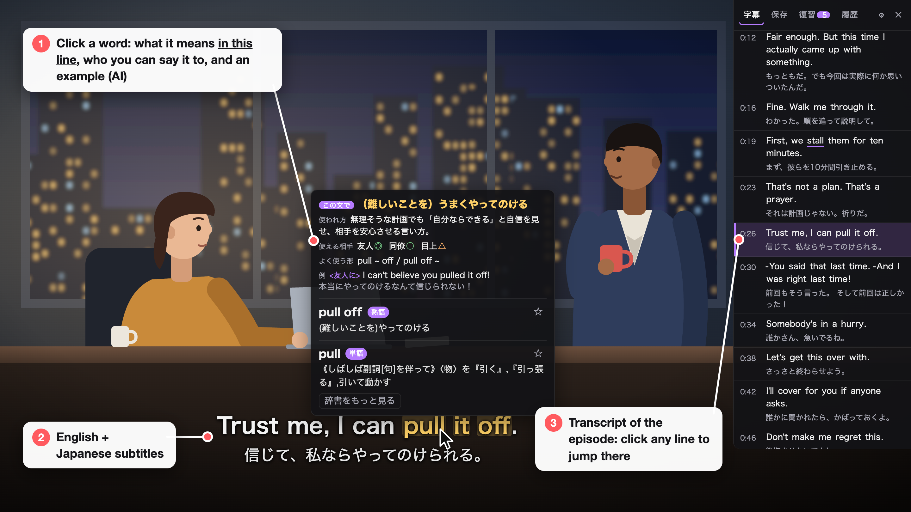

# Netflix Dual Subs

**For Japanese speakers learning English: watch Netflix with English and Japanese subtitles,
click any word to see what it means in that line, and review the words you looked up.**

Netflixで英語を学ぶ日本語話者のための Chrome 拡張。英日の二重字幕で観ながら、単語をクリックするとその場面での意味が分かり、調べた単語はあとで復習できます。




A Chrome extension (Manifest V3) in the spirit of Language Reactor: dual subtitles, a clickable
transcript, an idiom-aware hover dictionary, AI explanations of a word *in its context*, and
spaced-repetition review built from the words you looked up.

<sub>Screenshots use a stand-in player page and made-up dialogue (`tools/screenshots.mjs`); nothing from Netflix is shown.</sub>

> Personal, non-commercial project. Not affiliated with or endorsed by Netflix. It is not
> published on the Chrome Web Store, does not download or record video, and does not touch
> DRM; it only reads the subtitle tracks the player already loads. Netflix may change its
> player at any time and break it.

## Features

- **Dual subtitles**: English on the video, Japanese in the side panel (blurred until you hover,
  or press <kbd>J</kbd>). Japanese is machine-translated by default, because official
  Japanese subtitles are often loose or shortened; the official ones are one switch away.
- **Transcript panel**: every line of the episode; click a line to jump there. The current line
  stays centered. Hovering the panel pauses the video.
- **Hover dictionary with idioms**: looks up the longest phrase (2–6 words) around the word
  under the cursor, so *figuring **it** out* finds *figure out* and *gave up* finds *give up*.
- **AI explanation on click**: what the word means in *this* line, how it's used, a common
  pattern, an example sentence, and whether you could say it to a friend / a colleague /
  your boss (◎○△×). Claude Haiku if you set a key, otherwise Gemini, otherwise Chrome's
  on-device Gemini Nano.
- **Learning loop**: save words (☆), jump back to the scene from the saved list or the lookup
  history, export to Anki CSV, and review with four question types (meaning, fill-in-the-blank,
  Japanese→English, listening) on a 0/1/3/7/21-day schedule.
- **Keyboard**: <kbd>,</kbd> previous line, <kbd>.</kbd> again, <kbd>/</kbd> next line,
  <kbd>R</kbd> repeat line, <kbd>Q</kbd> pause after each line, <kbd>P</kbd> panel.
  Keys are matched by physical position, so they work with a Japanese IME on.
- Sound effects, speaker names and lyrics (`[sighs]`, `NORAH:`, `♪…♪`) are stripped.

## How it works

```
Netflix page ─────────────────────────────────────────────────────────────────────
  inject.js  (MAIN world)     reads subtitle track URLs from the player's state,
                              seeks through the player's own API
      │ window.postMessage
  content.js (isolated world) all UI: subtitles, panel, popups, quiz, shortcuts
  lib.js                      pure functions: VTT/TTML parsing, cue alignment,
                              tokenizing, lemmas, phrase lookup (tested with node)
      │ chrome.runtime.sendMessage
background.js (service worker) fetches subtitle files (CORS), translation,
                              AI requests, daily backup
keystore.js                   API keys in the extension's own IndexedDB
options.html / options.js     settings page: keys, usage log, backup / restore
```

Some decisions worth noting:

- **Reading tracks, not hooking requests.** An earlier version patched `JSON.parse` /
  `JSON.stringify` to catch the manifest; the player stopped passing through them and the
  hook was a suspect in first-load hangs. The extension now finds the player segment whose
  `movieId` matches the URL and reads its parsed track list, re-posting for a minute because
  some tracks get their URLs late.
- **Seeking.** Setting `video.currentTime` makes Netflix error out, so seeks go through the
  player API. That API lands slightly early, so the target line is held as "current" for up
  to 1.5 s to stop the transcript from jumping back a line.
- **API keys never enter the Netflix tab.** Keys live in IndexedDB that only the service
  worker and the settings page open. The content script sees only a flag saying which AI to
  use. Keys go in request headers only and are never logged or backed up.
- **Cost control.** AI runs only on click, never on hover. Each answer is cached per
  `movie | line | word`, so looking again costs nothing. A Claude lookup costs about
  $0.0002 (Haiku, JSON-schema output, thinking off; measured over 32 real lookups), and the
  settings page shows a usage log computed from the token counts the API returns.
- **Structured output in writing order.** The JSON schema puts "who can you say this to"
  before the example sentence, so the model picks the audience first and then writes an
  example that fits it.
- **Backups.** Saved words, history and AI answers are written to
  `Downloads/NetflixDualSubs/backup.json` once a day (plus a monthly copy), and merged back
  on restore. After a reinstall, the automatic backup writes to a separate file until you
  restore, so an empty profile can't overwrite the last good backup.

## Install

1. Clone the repository.
2. `chrome://extensions` → turn on Developer mode → **Load unpacked** → choose `ext/`.
   (If the repository is on an external drive, run `tools/install.sh` and load the copy it
   makes on the internal disk instead: Chrome drops unpacked extensions whose folder is
   missing at startup.)
3. Optional: open the extension's options and add a Claude or Gemini API key.
4. Turn off Language Reactor if you have it (the subtitles would overlap).

The extension ID is pinned with the `key` in `manifest.json`, so the saved data stays with
the extension even if the folder moves.

## Development

```bash
node tests/test.js          # phrase lookup, lemmas, parsers, SDH stripping
node tools/screenshots.mjs  # UI check: runs the real UI on a stand-in player page in
                            # headless Chrome and writes docs/screenshot-*.png
python3 tools/build_dict.py # rebuild ext/dict.json (pip install wn)
```

Debug logs in DevTools are prefixed with `[NDS]`.

## Notes

- Translation uses Google Translate's free, unofficial `translate_a/single` endpoint, falling
  back to Chrome's built-in `Translator` API. It may stop working at any time.
- Dictionary data: EJDict (CC0) and Open Multilingual Wordnet (English and Japanese
  WordNet). See [THIRD_PARTY_NOTICES.md](THIRD_PARTY_NOTICES.md).
- Code: [MIT](LICENSE).

---

## 日本語

Language Reactor 風の自分用 Chrome 拡張。Netflix で英語＋日本語の二重字幕、字幕一覧、熟語対応のホバー辞書、
クリックした単語の文脈での意味（AI）、保存単語・履歴からの復習ができます。
インストールは上の Install の手順を参照。
